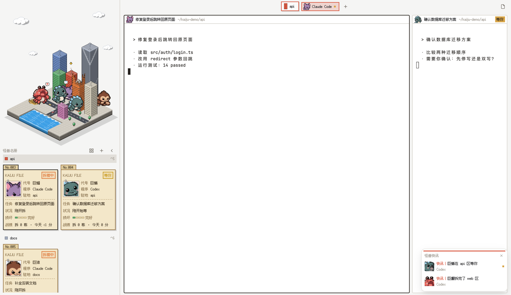

# Kaiju City · 怪兽城市布局 for Herdr



**中文**：Herdr 的一套等距像素风窗口布局。左上是一座小城市沙盘，每个 space 是一栋楼；每个 Agent 是一只原创萌系怪兽。Agent 开始干活，怪兽就从海里走上岸去拆楼；拆完了就在废墟上咆哮，等你回话时就挥手、楼顶亮起警报灯。下面是「怪兽名册」，可以在档案卡和头像两种模式之间切换。后台 Agent 完成时，右下角会弹出怪兽快讯。系统切到深色时，城市变成亮灯的夜景。

**English**: An isometric pixel-art layout for [Herdr](https://herdr.dev). A little city sits in the top-left corner: every space is a building, and every agent is an original cute monster. When an agent starts working, its monster walks out of the sea and starts smashing its building. When the agent finishes, the monster roars on the ruins; when it needs you, it waves and a siren lights up on the roof. Below the city, the monster roster shows a dossier card (or a small avatar) for each agent. A news card pops up when a background agent finishes, and in dark mode the city turns into a night scene with lit windows.

## 功能 / Features

- 8 栋楼、8 只原创怪兽（巨蜥、巨猿、巨蟹、美西螈、雪怪、巨蛾、巨龟、巨蝠）/ 8 buildings and 8 original monsters
- 楼会随 Agent 工作时间逐级损坏，你看过后自动修好 / Buildings take damage the longer an agent works, and repair after you look
- 怪兽名册：机密档案卡（任务、计时、损坏、战绩）或头像小方块 / Roster of dossier cards (task, timer, damage, record) or small avatars
- 顶栏胶囊和 tab 显示怪兽头像，窗格头部显示程序和目录 / Top capsule and tabs with monster heads; pane headers with program and folder
- 怪兽快讯：后台 Agent 拆完了或在等你 / News card when a background agent is done or blocked
- 像素字体 Fusion Pixel，浅色和深色自动切换 / Fusion Pixel font; light and dark themes follow the system

## 安装 / Install

```sh
git clone https://github.com/Jiqize/herdr-kaiju.git
cd herdr-kaiju
./install.sh
herdr-app do layout.switch '{"name":"kaiju"}'
```

`install.sh` 只复制 kaiju 自己的文件到 `~/.config/herdr-app/`（遵守 `HERDR_APP_HOME`），并把 `cmd-b` 合并进 `keys.json`。如果 `cmd-b` 已经绑定了别的功能，它会先问你，默认不改；改动前会先备份。安装不需要 Python 以外的依赖，所有图片都已生成好。

`install.sh` copies only Kaiju's own files into `~/.config/herdr-app/` (and respects `HERDR_APP_HOME`). It merges `cmd-b` into `keys.json`, asks before replacing an existing binding (default: keep it), and backs the file up first. All art ships as ready-made PNGs.

## 快捷键 / Keys

| 键 / Key | 作用 / Action |
|---|---|
| `cmd-b` | 展开 / 收起侧栏 · expand / collapse the sidebar |
| `ctrl-1…9` | 跳到第 N 个 space · go to space N |
| `cmd-1…9` | 跳到第 N 个 tab · go to tab N |
| `ctrl-shift-l` | 切换布局 · switch layout |
| 点楼 / click a building | 切到这个 space · select its space |
| 点怪兽或名册卡片 / click a monster or card | 跳到它的窗格 · focus its pane |

## 换怪兽 / Swap the monsters

怪兽阵容由 `art/roster.json` 决定。放一张 5 个动作的动作表（待机、走路、冲撞、咆哮、挥手，白底一排），在清单里加一行，再运行 `python3 -I art/build_assets.py`（需要 Pillow 和 numpy）和 `./install.sh`。详见 [RECIPE.md](RECIPE.md)。

The roster lives in `art/roster.json`. Add a 5-pose sprite sheet, add a line to the list, then run `python3 -I art/build_assets.py` (needs Pillow and numpy) and `./install.sh`. See [RECIPE.md](RECIPE.md).

## 卸载 / Uninstall

用 `ctrl-shift-l` 切回其他布局，再删除 `~/.config/herdr-app/` 下的这些文件：`layouts/kaiju.json`、`layouts/kaiju.svg`、`themes/kaiju.json`、`themes/kaiju-night.json` 和 `mods/kaiju/`。

Switch away with `ctrl-shift-l`, then delete those same files.

## 致谢 / Credits

- 像素字体 [Fusion Pixel Font](https://github.com/TakWolf/fusion-pixel-font)（SIL Open Font License 1.1，见 `mods/kaiju/fonts/OFL.txt`）
- 怪兽动作表由 Codex 生成，再用 `art/pixelize.py` 统一像素化；城市由 `art/render.py` 程序绘制

Requires Herdr GUI (built and checked on 0.1.11, macOS). Code: MIT License. Font: OFL 1.1.
