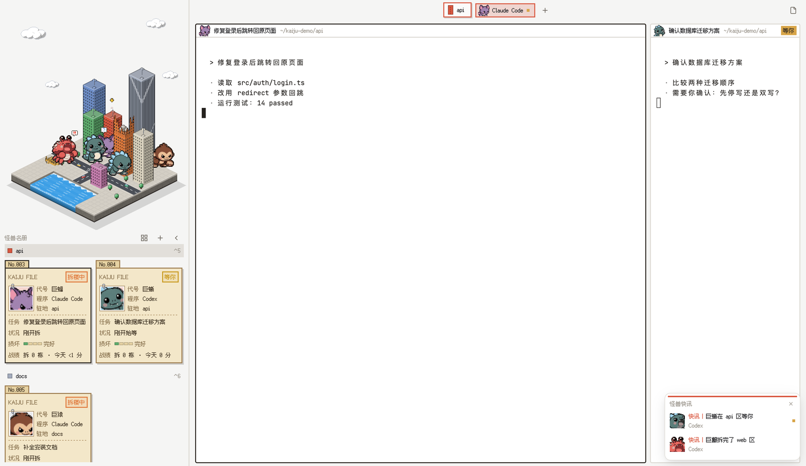

# Kaiju City

An isometric pixel-art Herdr window. A little city fills the top of the left sidebar: every space is a building, every agent is an original cute monster, and the agent's status drives what the monster does to its building. Below the city, a "monster roster" lists the agents as dossier cards or small avatars. The top bar and the pane headers show monster heads, and a news card pops up when a background agent finishes. Light by default, a lit night city when the system is dark. All text uses the Fusion Pixel 12 px font.

## What you see

Left to right, top to bottom:

- **Sidebar** (400 px, `chrome` background, not resizable, 2 px `border` divider).
- **City** (top of the sidebar, 492 px tall, drags the window): a 400×480 isometric scene drawn 8 px from the top. Sky with 4 clouds, a square plate with two roads, a sea in the front-left corner, trees and small cars. 8 building slots, filled by spaces in order: blue `#6f8fc9`, orange `#e07a3c`, green `#5fae6e`, beige `#ddd5c1`, red `#d9573f`, glass `#a3acbd`, yellow `#d8a548`, pink `#c87fb0`. Empty slots show a bare lot. Spaces after the 8th get no building. A bouncing yellow arrow floats 12 px above the current space's roof.
- **Monsters**: 8 original chibi monsters, 60 px tall, 5 frames each (idle, walk, smash, roar, wave): 巨蜥 lizard, 巨猿 ape, 巨蟹 crab, 美西螈 axolotl, 雪怪 yeti, 巨蛾 moth, 巨龟 turtle, 巨蝠 bat. Agents get them in order of appearance, cycling through the list. Monsters and buildings are stacked by real depth, so a front building can hide part of a monster standing behind it.
- **Monster roster** (below the city): a "怪兽名册" header with a mode toggle, + (new space) and ‹ (collapse). Then, per space, a 28 px row (a 10 px square in the building color, the name, `⌃N` for the first nine; the current space has the `selected` background), followed by its agents:
  - **Dossier mode** (default), two per row, 184 px wide: a kraft-paper card (`#f3e7c9`, dark brown `#2b2721` at night) with a folder tab "No.001…", a hard 3 px shadow, "KAIJU FILE" and a status stamp (睡觉中 gray, 拆楼中 orange, 拆完了 red, 等你 yellow), a paper-clipped photo with the 48 px monster face (expression follows the status), the fields 代号 (monster name), 程序 (program), 驻地 (tab name, or the space name), a dashed rule, then 任务 (terminal title with the program and space names removed; "未登记" when empty), 状况 (timer such as "拆了 3 分钟" / "等了 2 分钟" / "5 分钟前拆完", or a one-line quip), 损坏 (a 4-cell damage bar: 完好 / 轻损 / 重损 / 废墟, "场外" when the space has no building) and 战绩 ("拆 3 栋 · 今天 1 时 5 分").
  - **Avatar mode**: one 56 px tile per agent (48 px face in a photo frame, border in the status color), six per row. Details are in the tooltip.
- **Collapsed sidebar** (76 px, city hidden): one 48 px tile per space with a 30 px building icon in its color and an 8 px status light (working pulses). On macOS it leaves 50 px at the top for the traffic lights. At the bottom: +, settings and ›.
- **Top bar** (44 px, `canvas`, drags the window). Centered: a 32 px space capsule (2 px border in the building color, a 20 px building icon, the name, a 2 px hard shadow), then the tab pills (30 px, 2 px border, a 24 px head of the tab's first agent, or a brick when it has none). The current tab is filled with the building color mixed 80 % toward `chrome` and has a border in the building color. A blocked tab ends in a 6 px yellow square. Then a + button. On the far right: 30 px Files and Changes toggles.
- **Work area**: padding [6, 12], gap 10. Every pane is a card with radius 4 and a 2 px `border` (`input` when focused). Its 28 px header holds a 24 px monster head (or a brick), the program name (or terminal title), and the folder in `dim` (home shown as `~`). Blocked panes get a yellow "等你" tag.
- **Side panel** (hidden, 368 px, radius 4, 2 px `border`): Herdr's Files and Changes.
- **News card** (floating, right edge, bottom; Herdr draws the frame): 286 px wide, a 3 px red strip, a "怪兽快讯" header with ×, and up to 3 rows of 48 px: a 32 px roaring face, "快讯｜巨蜥拆完了 api 区" or "快讯｜巨猿在 docs 区等你", and the program name. Blocked rows end in a 6 px yellow square. "还有 N 条" follows when there are more.

**Themes**: `kaiju` (light) has canvas/chrome `#f5f5f4`, surface `#fbfbfa`, selected `#e2dfda`, border `#dedbd5`, input `#2b2620`, accent `#e07a3c`. `kaiju-night` (dark) has canvas/chrome `#0e1117`, background `#12161d`, selected `#262e3b`, border `#232a35`, input `#4fd1e5`, accent `#ffd877`. The night art darkens buildings, lights random windows warm yellow, darkens monsters to 78 % and keeps cyan parts (the lizard's back spikes) glowing.

## How it behaves

- **Status → monster** (only agents whose space has a building appear on the city; idle agents stay in the roster):
  - working: the monster walks from the sea to its building (900 ms, walk frame) and plays the smash frame, shaking ±1 px. The building shakes and a dust cloud pulses at its base.
  - done: roar frame with a "!!" bubble.
  - blocked: wave frame with a "?" bubble, and a red siren blinks on the roof.
  - idle again: the monster walks back to the sea and disappears.
- **Damage**: working for 2 minutes → light damage (broken windows, smoke); 8 minutes → heavy (jagged top); done → ruin; blocked keeps the current level. Back to idle, the building repairs one level every 650 ms. Damage is computed per agent, so a done agent still leaves ruins when another agent in the same space is blocked.
- **Stands**: each building has 2–4 stands, picked when the art is generated: close to the building, mostly visible, not covering most of a short building. More monsters reuse the stands, each round 6 px further forward.
- **New space**: its building rises from the ground with a spring.
- **Clicks**: a building selects its space; a monster, a card or a tile focuses the agent's pane. Click areas stack the same way the picture does. Right-click a space row or rail tile for Herdr's space menu.
- **Roster**: the mode toggle switches between dossier and avatar mode and is remembered. Timers refresh at the next whole minute, and only while some agent is working. The record counts one building per finished round of work (working → done or idle) and today's working time, reset at midnight.
- **Collapse**: ‹ / › or `cmd-b` in this layout hides the city and resizes `sidebar` between 400 and 76 px.
- **Top bar**: click the capsule to rename the space. Click a tab to select it, double-click to rename, drag onto another to reorder, right-click for Herdr's tab menu. The wheel over the bar switches tabs.
- **Pane header**: click to focus. On hover it shows split right, split down, zoom/unzoom and close.
- **News**: an agent joins the card when its status changes to done or blocked while it isn't focused. Agents seen for the first time don't count. Newest on top, one row per agent; the face drops in with a spring. Clicking a row focuses that pane and removes the row. A row also leaves when its agent gets focus, its status moves on, or the agent goes away. × clears the card; an empty card draws nothing.
- **Light/dark** follows the system (or `appearance` in settings.json).

## Built from

- `layouts/kaiju.json`: the root `row` (titlebar none, traffic_lights [16, 18], theme `{light: "kaiju", dark: "kaiju-night"}`, ui_font `Fusion Pixel 12px Prop zh-Hans`, terminal_padding [12, 10], 2 px `border` dividers) holds:
  - `sidebar` column (px 400, not resizable, `chrome`) with `city` (px 492, `window_drag`, part `city`) and `roster` (part `roster`)
  - `work` column with `tabs` (px 44, `window_drag`, part `top`) and `work-body` row (padding [6, 12], gap 10): `main` (`{tab: "active", pane: {radius 4, 2 px border, focus 2 px input, header: {content: {mod: "kaiju"}, height: 28}, lone: true}}`) and `panel` (hidden column, stack `panel-body` with the shipped `files` and `changes`)
  - root `floating`: `[{id: "news", content: {mod: "kaiju", props: {part: "news"}}, edge: "right", align: "end"}]`
- `mods/kaiju/` is one mod with several roles. `main.js` picks one: `props().pane` → pane header (`pane.js`); `part` `city` (`city.js`), `roster` (`roster.js`), `top` (`top.js`) or `news` (`news.js`). `state.js` holds the shared logic: night detection, asset paths, space → slot, damage levels with one-shot wake-ups, monster assignment, monster behaviors. `strings.js` holds every UI string in a `zh` table (default) and an `en` table; `S()` returns the current one, `shared("kaiju.lang")` picks it, `toggleLang()` flips it (the `EN`/`中` button in the roster header, or the `kaiju.lang` mod command). Monster names come from the manifest unless the language table overrides them. The dossier label column is 28 px in Chinese and 46 px in English.
- `mods/kaiju/assets/{day,night}/`: the plate, every slot at 4 damage levels plus an empty lot, monster frames, heads (48 px), avatars (96 px shown at 48), roaring faces, and effects (arrow, bubbles, siren, dust, brick, paper clip). `manifest.json` / `manifest.js` describe the canvas, slots (roof heights, stands with depth, hit boxes), the entry point, monsters and effect sizes. Everything is drawn at 1 art pixel = 1 logical pixel and exported 2× with nearest-neighbor scaling.
- `mods/kaiju/fonts/`: Fusion Pixel 12 px proportional (zh_hans), OFL. `mods/kaiju/icons/`: the roster mode icons. `keys.json`: `{"layout:kaiju": {"cmd-b": "kaiju.toggle"}}`.
- Shared state: `kaiju.monsters` (agent → monster), `kaiju.damage` (space → level, written by the city for the roster), `kaiju.stats` (record), `kaiju.roster` (mode).
- `art/`: `render.py` draws the city, `pixelize.py` turns an AI sprite sheet into pixel frames, `build_assets.py` builds everything into `mods/kaiju/assets/` and writes check images to `art/samples/`.
- `herdr` functions used: `spaces`, `panes`, `agents`, `setAgentOrder`, `run`, `openOverlay`, `props`, `theme`, `window`, `shared`, `setShared`, `layout`, `nextCommand`, `home`.
- Commands it runs: `space.select/new/rename`, `tab.select/rename/move/prev/next`, `pane.focus/split/zoom/close`, `layout.resize/show/hide/select`, `app.settings`.
- Shipped mods and icons it uses: `menu`, `new-menu`, `files`, `changes`, and icons from `mods/workspace-chrome/`, `mods/pane/`, `mods/files/` and `mods/changes/`.
- It runs no programs and makes no network calls.

### Swapping the monsters

1. Make a sprite sheet: one row of exactly 5 poses, left to right idle, walking, smashing, roaring, waving, on a plain white background with a clear gap between poses. The prompts in `art/ai/*/*.prompt.txt` show the style used here (chibi, big round head, dark 1 px outline, flat shading, facing down-right). Monsters must be original characters.
2. Put it in `art/ai/<name>/<name>-sheet.png` and add `{"id": "<id>", "name": "<名字>", "sheet": "art/ai/<name>/<name>-sheet.png"}` to `art/roster.json`. The list order is the order agents get monsters; remove a line to drop a monster.
3. Run `python3 -I art/build_assets.py` (needs Pillow and numpy). It scales every pose to 60 px, shares one palette, adds the outline, crops the heads around the eyes, makes the night versions and rewrites the manifest. Check `art/samples/assets-check.png`.
4. Run `./install.sh`. No code changes are needed.

## Watch out

- A pane header copy only gets `{pane, terminal}` as props, so it is detected by `props().pane`, not by `part`.
- Only the `roster` copy listens to `nextCommand()`; another copy awaiting it too would compete for the command.
- Herdr's "done" only clears when you actually look at the agent; `pane.focus` from a command doesn't clear it. Until then the monster stays on its ruins.
- There is no repeating timer. Walking, rising, damage steps and minute timers all use one-shot `cx.timer.after`; shaking and blinking use native `.loop()` animations. With no agent working, the mod doesn't redraw.
- The floating news frame (background, border, rounded corners, shadow) is drawn by Herdr and can't be removed; the mod draws only the content. Herdr's own toast still shows next to it.
- The font file is 7 MB. Layout fonts load from `mods/kaiju/fonts/` at start and on the next look change.
- Themes must be copied to `themes/`; a layout folder alone isn't enough.
- `install.sh` merges `keys.json`, asks before replacing a key that is already bound, and backs the file up first.
- Built and checked on macOS with Herdr 0.1.11 only.

## Done when

- `herdr-app check ~/.config/herdr-app/mods/kaiju` passes, and `herdr-app status` lists no kaiju errors.
- `layout.switch {name: "kaiju"}` shows the city, the roster, the top bar and the pane headers in the pixel font. Each space has a building, and the current one has the arrow.
- An agent set to working walks to its building and smashes it; blocked waves under a roof siren; done roars on the ruins; back to idle it walks away and the building repairs.
- The roster mode toggle switches between dossier cards and avatars and stays after a restart.
- `cmd-b` collapses the sidebar to 76 px and back.
- When an agent in a background tab finishes, the news card appears, and clicking it jumps to that agent.
- With `"appearance": "dark"` in settings.json, the city turns into the night scene with lit windows.
